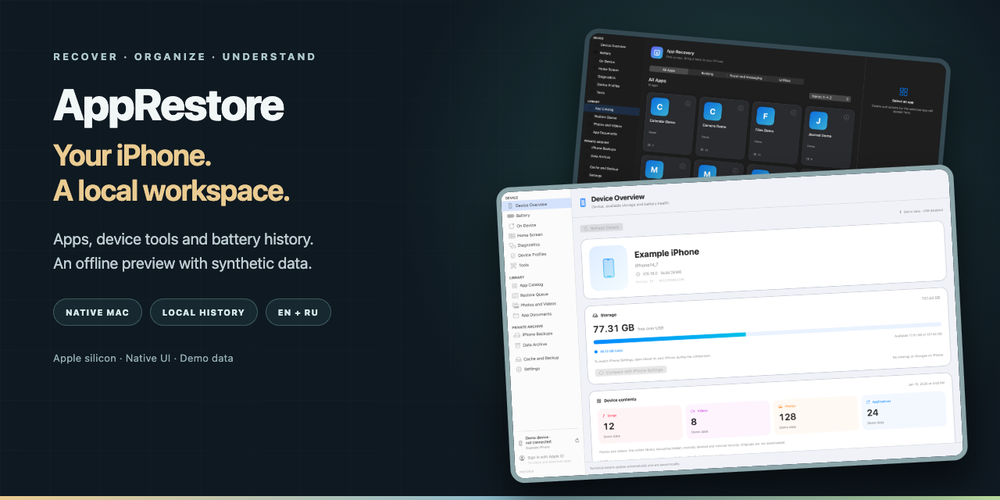
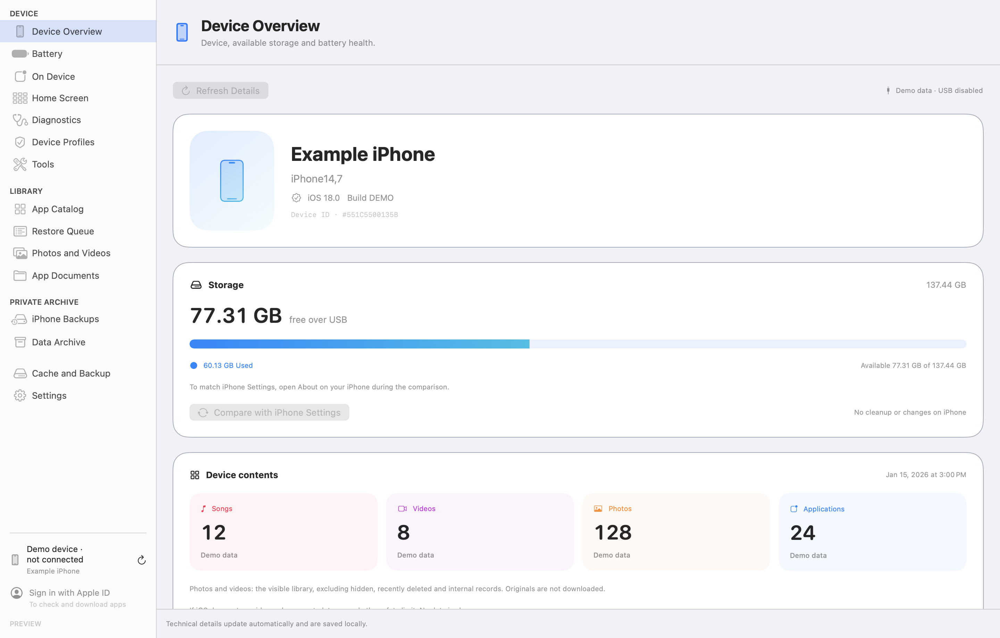
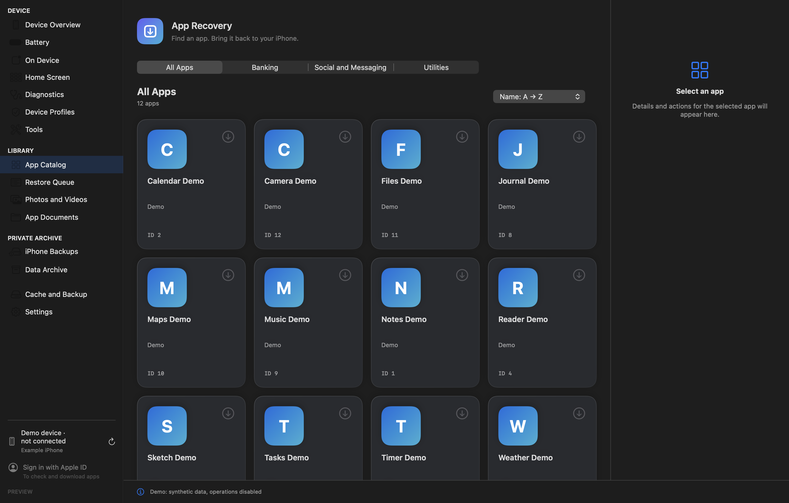
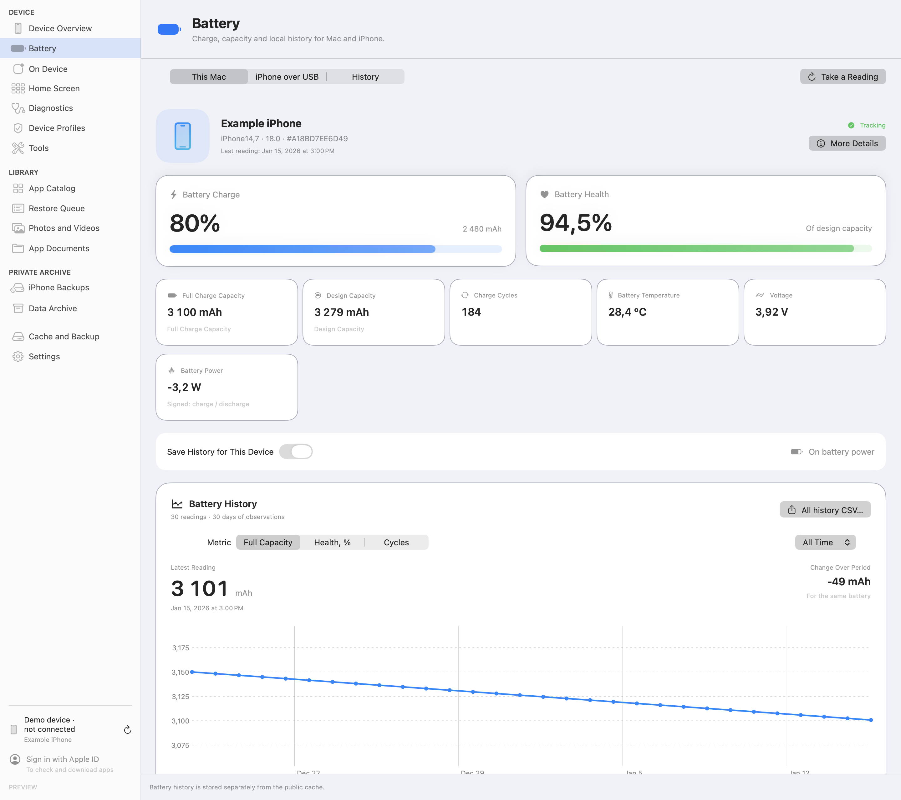
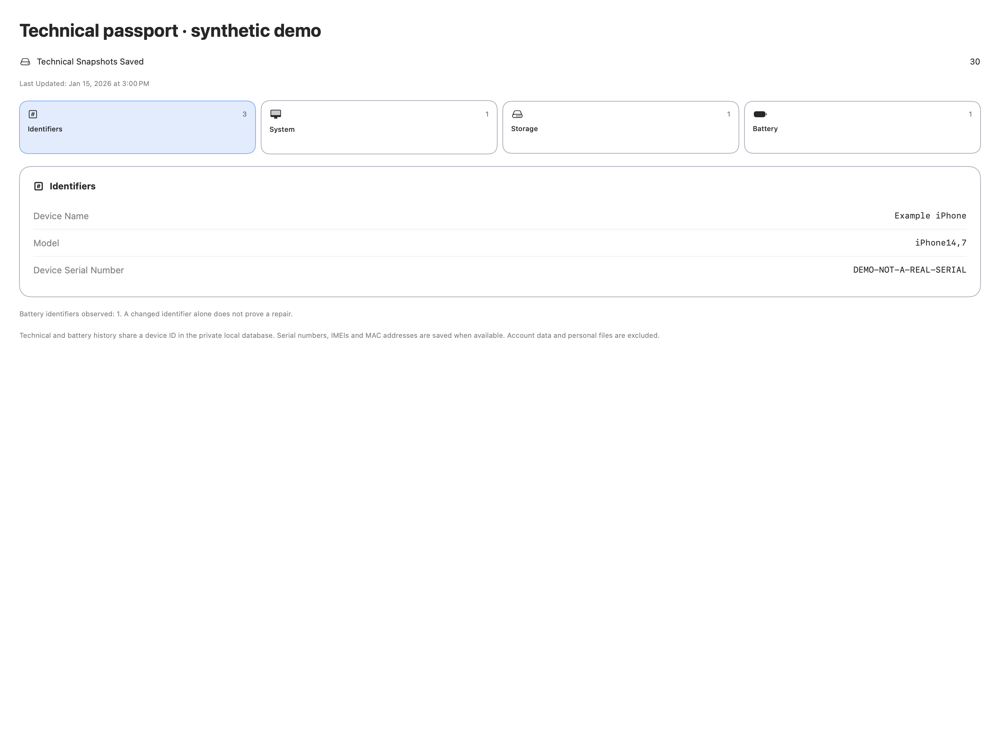

# AppRestore

[English](README.md) · [Русский](README.ru.md)



[Start locally](#start-locally) · [Screenshots](#screenshots) · [Build the full application](#build-the-full-application) · [Data and permissions](#data-and-permissions)

A native macOS workspace for Apple app recovery, trusted iPhone tools, and local battery history. This public adaptation is based on **AppRestore 0.8.13 build 43**, with the **0.8.2 Apple engine protocol**. Its public edition is **0.8.13-public.1**.

The interface and documentation support **English and Russian**. The screenshots use invented data in the actual native SwiftUI views. They do not show a real connected device or an authenticated Apple account.

> Source preview. Build the offline interface or full application locally. A ready-to-download notarized installer is not included in this source edition.

## Features

- A native SwiftUI/AppKit device workspace, app catalog, restore queue and local cache.
- Apple login/2FA, app availability checks and download/package verification through a modified ipatool engine. Apple decides whether the current account may obtain an app.
- Trusted iPhone tools, selected local USB photo/video exports and app File Sharing operations. Available on-device files are distinct from all iCloud originals.
- Local battery readings/history, technical passports and explicit exports. The optional coconutBattery importer requires a selected backup and the user's locally installed application; its binary and format key are not bundled.
- A separate, read-only offline preview with synthetic fixtures. It blocks the Apple and USB bridges.

Implementation is not a claim that every device, iOS version or workflow was accepted. See [VALIDATION.md](VALIDATION.md).

## Start locally

Requirements: an Apple silicon Mac, macOS 14 or newer, an installed Apple SDK/Command Line Tools and Python 3. This recipe has been compiled on one development Mac; Intel and a clean second Mac have not been tested.

```sh
APPRESTORE_BUILD_ROOT="$(mktemp -d -t apprestore-preview)/build"
python3 tools/build.py preview --output "$APPRESTORE_BUILD_ROOT"
open "$APPRESTORE_BUILD_ROOT/AppRestore Preview.app"
```

Expected result: **AppRestore Preview.app** opens a native workspace. Choose **App Catalog** to see the small synthetic catalog. No account is embedded; Apple and USB operations are disabled. This is an interface demonstration, not a simulated successful restore. Build output is created outside the source tree; an existing output directory is rejected.

## Screenshots

Real native views from this public source, captured offscreen on macOS with synthetic fixtures. The preview labels identify demo data and disabled device connections. The Russian README uses the Russian overview; the other shared screens use English. Click for full resolution.

<table>
<tr>
<td align="center"><strong>Device overview · synthetic values</strong><br><a href="docs/assets/overview-en.png"></a></td>
<td align="center"><strong>App catalog · dark theme</strong><br><a href="docs/assets/catalog-en.png"></a></td>
</tr>
<tr>
<td align="center"><strong>Battery and local history</strong><br><a href="docs/assets/battery-en.png"></a></td>
<td align="center"><strong>Technical passport</strong><br><a href="docs/assets/passport-en.png"></a></td>
</tr>
</table>

## Build the full application

The preview requires no Apple/USB runtime. A full build additionally needs **Go 1.27+**, **Python 3.12**, the pinned Python packages and network access for dependencies. Apple runtime assets are intentionally excluded from this source package.

```sh
APPRESTORE_FULL_ROOT="$(mktemp -d -t apprestore-full)"
python3.12 -m venv "$APPRESTORE_FULL_ROOT/venv"
"$APPRESTORE_FULL_ROOT/venv/bin/python" -m pip install -r requirements-lock.txt
python3 tools/fetch_upstream_profile.py --output "$APPRESTORE_FULL_ROOT/upstream-profile.go"
python3 tools/build.py full --output "$APPRESTORE_FULL_ROOT/build" \
  --python "$APPRESTORE_FULL_ROOT/venv/bin/python" --go go \
  --profile-file "$APPRESTORE_FULL_ROOT/upstream-profile.go" --prepare-runtime
```

The explicit profile step fetches one pinned upstream file containing Apple-derived materials into the external build workspace; it verifies its exact size and SHA-256 and does not place it in the source tree. The explicit `--prepare-runtime` step downloads pinned runtime components from Apple/Python sources before ad-hoc signing. These steps do not log in to Apple, acquire an app or modify an iPhone. Without runtime preparation, Apple operations remain unavailable. USB packaging uses PyInstaller. The Go engine was built with the pinned upstream profile and passed a local ping; full public-bundle, fresh runtime preparation and clean-machine acceptance are described separately in [VALIDATION.md](VALIDATION.md).

Local builds are **ad-hoc signed, not notarized**. Developer ID/notarization and clean-Mac first launch have not been completed. This repository does not claim trusted one-click distribution, include a signing identity, or disable Gatekeeper.

## Architecture

| Layer | Language | Role |
| --- | --- | --- |
| Native interface and local workflows | Swift | SwiftUI, AppKit, SQLite, device/battery views |
| Apple engine | Go | Modified ipatool, pipe/JSON protocol, package checks |
| USB helper | Python | pymobiledevice3/pyiosbackup integration and selected local operations |
| Build/capture scripts | Python and Swift | Explicit bundle assembly and synthetic native UI capture |

See [THIRD_PARTY_NOTICES.md](THIRD_PARTY_NOTICES.md) for origin and component licenses. This is not an application written entirely from scratch in a single language.

## Data and permissions

- Public storage is separate: `AppRestorePublic` under the user's Application Support. `APPRESTORE_DATA_HOME` can explicitly choose another absolute data directory; symbolic-link and parent-traversal components are rejected. Preview data uses a temporary directory by default.
- No account, password, token, pairing record, IPA/SINF, database, private device history or proprietary Apple runtime is included.
- Full mode may store account names, selected device identifiers and battery/passport history locally. SQLite/history and account-name files are not encrypted. Password saving is optional and depends on supported Keychain/code-signing conditions; ad-hoc builds do not imply this capability.
- Full catalog/artwork access uses public upstream/Apple endpoints. Apple sign-in, app availability, downloads and acquisition are separate actions. A trusted/unlocked iPhone and normal macOS/device permissions are required for relevant USB features.
- App installation, exports, imports and backup operations can write files or device data when the user explicitly starts them. Preview bridges reject those operations.
- A library backup is opt-in through `APPRESTORE_LIBRARY_BACKUP_DIR`. There is no preconfigured external drive, volume identifier or private destination. Existing bounded copy/manifest/SHA verification is retained; no automatic deletion is added.

## Validation and limits

The updated Go engine passed local synthetic tests; the Swift UI passed type checking. The screenshots are native offscreen renders, not physical-iPhone acceptance. See [VALIDATION.md](VALIDATION.md) for exact scope, earlier results and untested integration scenarios.

Use only your own authorized Apple account and data. This program cannot guarantee recovery of every delisted app, transfer purchases to another account, fetch every iCloud original, or perform a complete phone migration.

## License and contribution

The combined AppRestore distribution uses **GPL-3.0-only**; see [LICENSE](LICENSE). AppRestore-authored code: Copyright (c) 2026 ginscorp. MIT components retain their original notices; GPL and other third-party conditions remain applicable. No blanket MIT license is claimed for the combined product. See [THIRD_PARTY_NOTICES.md](THIRD_PARTY_NOTICES.md).

Agents and contributors should read [AGENTS.md](AGENTS.md), preserve synthetic fixtures and keep credentials, real accounts, private endpoints and device data out of source, media and metadata.
