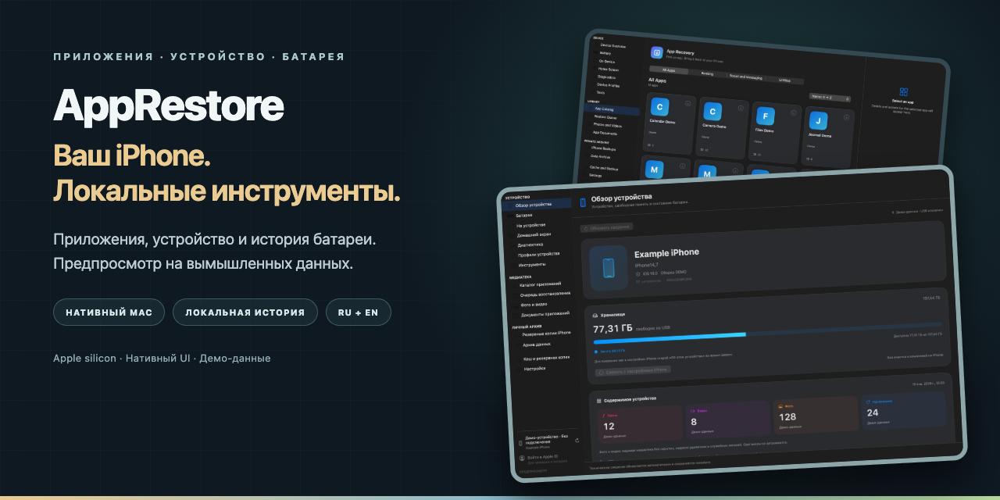
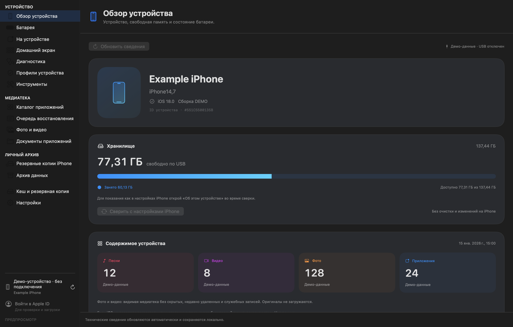
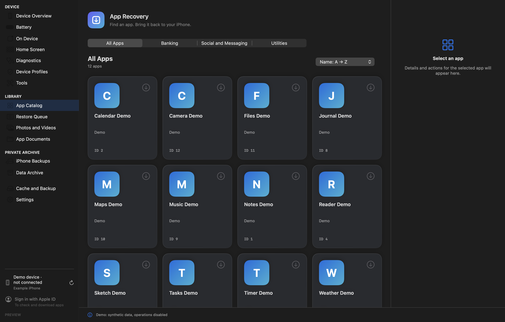
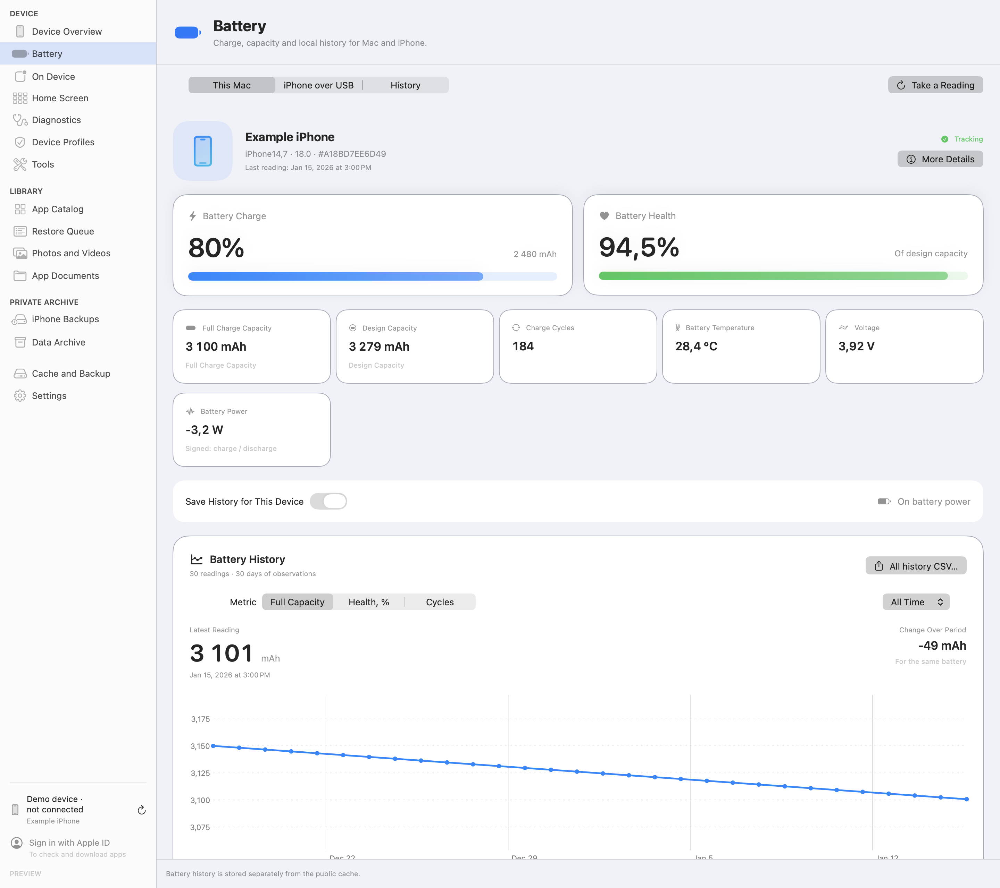
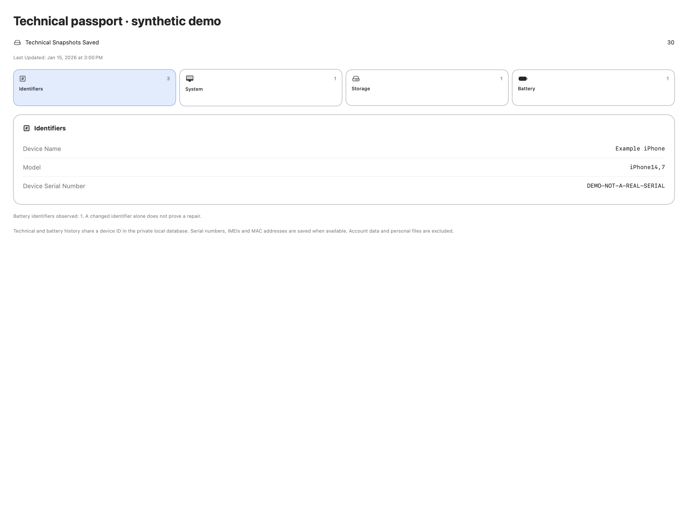

# AppRestore

[English](README.md) · [Русский](README.ru.md)



[Локальный запуск](#локальный-запуск) · [Скриншоты](#скриншоты) · [Полная сборка](#полная-сборка) · [Данные и права](#данные-и-права)

Нативное macOS-приложение для восстановления доступных приложений Apple, работы с доверенным iPhone и локальной истории батареи. Основа — **AppRestore 0.8.13 build 43**, **протокол Apple-engine 0.8.2**. Версия публичной адаптации — **0.8.13-public.1**.

Интерфейс и документация доступны на **русском и английском**. На скриншотах настоящие нативные SwiftUI-представления с вымышленными данными. Они не показывают реальное подключение устройства или авторизованный Apple-аккаунт.

> Исходная предварительная версия. Офлайн-интерфейс или полное приложение собираются локально. Готового notarized-установщика для скачивания в этом исходном комплекте нет.

## Возможности

- Нативное рабочее пространство SwiftUI/AppKit: устройство, каталог, очередь восстановления и локальный кеш.
- Apple login/2FA, проверка доступности, загрузка и проверка пакета через измененный ipatool. Право текущего аккаунта получить приложение определяет Apple.
- Инструменты доверенного iPhone, выбранный экспорт доступных локальных фото/видео по USB и File Sharing. Файлы на устройстве не равны всем оригиналам iCloud.
- Локальные показания/история батареи, технические паспорта и явные экспорты. Необязательный импорт coconutBattery требует выбранной копии и установленной пользователем программы; ее бинарник и ключ формата в комплект не входят.
- Отдельный офлайн-предпросмотр на синтетических данных с заблокированными Apple- и USB-мостами.

Реализация функции не означает приемку всех устройств, версий iOS и сценариев. См. [VALIDATION.md](VALIDATION.md).

## Локальный запуск

Нужны Mac на Apple silicon, macOS14+, установленный Apple SDK/Command Line Tools и Python3. Рецепт скомпилирован на одном рабочем Mac; Intel и чистый второй Mac не проверены.

```sh
APPRESTORE_BUILD_ROOT="$(mktemp -d -t apprestore-preview)/build"
python3 tools/build.py preview --output "$APPRESTORE_BUILD_ROOT"
open "$APPRESTORE_BUILD_ROOT/AppRestore Preview.app"
```

Результат: **AppRestore Preview.app** открывает нативный интерфейс. Выбери **Каталог приложений**, чтобы увидеть небольшую вымышленную подборку. Аккаунт не встроен; действия Apple/USB отключены. Это демонстрация интерфейса, а не имитация успешного восстановления. Сборка создается вне исходников; существующая выходная папка отклоняется.

## Скриншоты

Настоящие нативные представления текущего публичного кода, снятые невидимым тестовым окном macOS на синтетических данных. Метки обозначают демо и отсутствие подключения. Первый экран здесь русский, остальные общие кадры — английские. Нажми на изображение для полного размера.

<table>
<tr>
<td align="center"><strong>Обзор устройства · вымышленные значения</strong><br><a href="docs/assets/overview-ru.png"></a></td>
<td align="center"><strong>Каталог · темная тема</strong><br><a href="docs/assets/catalog-en.png"></a></td>
</tr>
<tr>
<td align="center"><strong>Батарея и локальная история</strong><br><a href="docs/assets/battery-en.png"></a></td>
<td align="center"><strong>Технический паспорт</strong><br><a href="docs/assets/passport-en.png"></a></td>
</tr>
</table>

## Полная сборка

Для предпросмотра Apple/USB-runtime не нужен. Полная сборка дополнительно требует **Go1.27+**, **Python3.12**, закрепленные Python-пакеты и сеть для зависимостей. Apple-runtime намеренно не входит в этот исходный комплект.

```sh
APPRESTORE_FULL_ROOT="$(mktemp -d -t apprestore-full)"
python3.12 -m venv "$APPRESTORE_FULL_ROOT/venv"
"$APPRESTORE_FULL_ROOT/venv/bin/python" -m pip install -r requirements-lock.txt
python3 tools/fetch_upstream_profile.py --output "$APPRESTORE_FULL_ROOT/upstream-profile.go"
python3 tools/build.py full --output "$APPRESTORE_FULL_ROOT/build" \
  --python "$APPRESTORE_FULL_ROOT/venv/bin/python" --go go \
  --profile-file "$APPRESTORE_FULL_ROOT/upstream-profile.go" --prepare-runtime
```

Отдельный шаг получает закреплённый upstream-файл с материалами Apple во внешнюю рабочую папку, проверяет точные размер и SHA-256 и не помещает файл в исходники. Явный шаг `--prepare-runtime` скачивает закреплённые компоненты из источников Apple/Python до локальной подписи. Эти шаги не выполняют вход Apple, получение приложения или изменение iPhone. Без подготовки runtime операции Apple недоступны. USB упаковывается PyInstaller. Движок Go собран с закреплённым upstream-профилем и прошёл локальный ping; результаты полной публичной сборки, новой подготовки runtime и проверки на чистом Mac отдельно указаны в [VALIDATION.md](VALIDATION.md).

Локальная подпись — **ad-hoc, без notarization**. DeveloperID/notarization и первый запуск на чистом другом Mac не выполнены. Репозиторий не обещает официальный доверенный запуск одним кликом, не содержит signing identity и не отключает Gatekeeper.

## Устройство проекта

| Слой | Язык | Назначение |
| --- | --- | --- |
| Интерфейс и локальные сценарии | Swift | SwiftUI, AppKit, SQLite, устройства и батарея |
| Apple-engine | Go | Измененный ipatool, pipe/JSON, проверки пакетов |
| USB-помощник | Python | pymobiledevice3/pyiosbackup и выбранные локальные операции |
| Сборка и съемка | Python и Swift | Явная сборка bundle и синтетический нативный предпросмотр |

Происхождение и лицензии — в [THIRD_PARTY_NOTICES.md](THIRD_PARTY_NOTICES.md). Это не приложение, полностью написанное с нуля на одном языке.

## Данные и права

- Публичные данные отделены: `AppRestorePublic` в Application Support текущего пользователя. `APPRESTORE_DATA_HOME` явно выбирает другую абсолютную папку; символические ссылки и переходы в родительские каталоги отклоняются. Демо по умолчанию использует временную папку.
- Аккаунты, пароли, токены, pairing, IPA/SINF, базы, личная история устройств и проприетарный Apple-runtime в комплект не входят.
- Полный режим может локально хранить имена аккаунтов, выбранные идентификаторы устройств и историю батареи/паспортов. SQLite и файлы имен аккаунтов не зашифрованы. Сохранение пароля необязательно и зависит от поддерживаемого Keychain/code signing; ad-hoc подпись не означает его доступность.
- Полный каталог/изображения обращаются к публичным исходным/Apple-адресам. Вход, доступность, загрузки и получение приложений — отдельные действия. USB-функциям нужны доверенный/разблокированный iPhone и обычные разрешения macOS/устройства.
- Установка приложений, экспорты, импорты и резервирование могут писать файлы или данные устройства по явному действию пользователя. В демо соответствующие мосты отклоняют запросы.
- Резервирование библиотеки включается явно через `APPRESTORE_LIBRARY_BACKUP_DIR`. Готового внешнего диска, volume ID и частного адресата нет. Сохранены ограничения копирования, манифест и SHA; автоматическое удаление не добавлено.

## Проверки и ограничения

Обновлённый движок Go прошёл локальные синтетические тесты; проверка типов Swift-интерфейса прошла. Кадры сняты невидимым нативным окном, это не приёмка физического iPhone. Точный охват, предыдущие результаты и непроверенные интеграции — в [VALIDATION.md](VALIDATION.md).

Использовать только свои разрешенные Apple-аккаунт и данные. Восстановление любого снятого приложения, перенос покупок другому аккаунту, все оригиналы iCloud и полная миграция телефона не гарантируются.

## Лицензия и участие

Общий выпуск AppRestore использует **GPL-3.0-only**; см. [LICENSE](LICENSE). Наш код AppRestore: Copyright (c) 2026 ginscorp. MIT-компоненты сохраняют исходные notices; GPL и другие условия зависимостей действуют отдельно. Единая MIT всему продукту не заявляется. См. [THIRD_PARTY_NOTICES.md](THIRD_PARTY_NOTICES.md).

Агенты и участники читают [AGENTS.md](AGENTS.md), сохраняют синтетические примеры и не включают доступы, реальные аккаунты, частные адреса и данные устройств в исходники, медиа или metadata.
